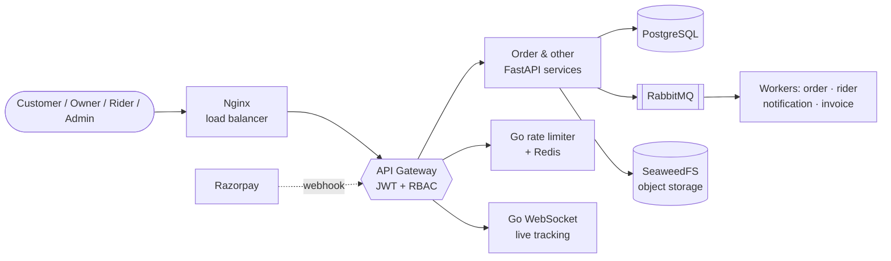

<div align="center">


<a href="https://github.com/Sukreet018">
  
</a>

<br/><br/>

<a href="https://www.linkedin.com/in/sukreet-biswas-6031b3361/"></a>
<a href="mailto:sukreet018@gmail.com"></a>
<a href="https://leetcode.com/u/ckZeMutkDL/"></a>
<a href="https://x.com/sukreet7"></a>
<a href="https://instagram.com/_sukreet_"></a>

<br/><br/>


</div>

<br/>

## ✨ About Me

```python
class Sukreet:
    role      = "Backend Engineer Intern (aspiring)"
    education = "B.Tech CSE (AI), Techno India University, 2026"
    based_in  = "Kolkata, India 🇮🇳"
    stack     = ["Python", "Go", "FastAPI", "PostgreSQL", "Redis", "RabbitMQ", "Docker"]
    also_does = ["NLP", "Transformers", "React"]
    learning  = ["Node.js & Go backends", "API design", "How system components talk"]
    ask_me_about = ["Full-stack project structure", "Breaking down problems", "Debugging logic"]
```

<table>
<tr>
<td align="center" width="25%"><h2>11</h2><sub>services in my largest<br/>microservices backend</sub></td>
<td align="center" width="25%"><h2>4.92</h2><sub>pages/sec from my<br/>20-worker Go crawler</sub></td>
<td align="center" width="25%"><h2>94.8%</h2><sub>accuracy, quad-Transformer<br/>fusion (paper under review)</sub></td>
<td align="center" width="25%"><h2>140K+</h2><sub>samples used in my<br/>emotion classification research</sub></td>
</tr>
</table>

<br/>

## 🚀 Featured Projects

<table>
<tr>
<td width="50%" valign="top">

### 🛵 [Velora](https://github.com/Sukreet018/Velora)
**Food-Delivery Microservices Backend**

11 deployable services (9 FastAPI, 2 Go) behind an Nginx load-balanced gateway with JWT validation and role-based, route-level authorization for customer, owner, rider and admin roles. Async processing through RabbitMQ with payment idempotency keys, a Redis-backed Go rate limiter, Go WebSocket live tracking, and a Razorpay webhook. React + TypeScript portals (~17K LOC).


</td>
<td width="50%" valign="top">

### 🕷️ [Wikipedia Graph Crawler](https://github.com/Sukreet018/web-crawler)
**Concurrent Go Crawler**

20-goroutine worker pool with a dynamic frontier that feeds discovered links back into the queue: 100 unique pages in 20.49 s. Atomic de-duplication with `sync.Map`, a 5 req/s ticker-based rate limiter, graceful shutdown via `context` and `os/signal`, and race conditions diagnosed and fixed.


</td>
</tr>
<tr>
<td width="50%" valign="top">

### 🎭 [Emotiverse](https://github.com/Sukreet018/Emotiverse)
**Emotion Analysis Platform**

Full-stack app with a Node.js backend and a FastAPI inference service serving BERT models in real time for sentiment and emotion analysis. JWT auth and Zustand-synced state on MongoDB. *In progress: splitting the monolith into FastAPI microservices.*


</td>
<td width="50%" valign="top">

### 🔬 TetraSense
**Quad-Transformer Fusion Research**

A fusion layer combining BERT, ALBERT, ELECTRA and ERNIE for emotion classification with optimized tokenization and output fusion. **94.8% accuracy** on 140K+ samples. Paper under review at the 7th International Conference on Frontier Technologies of Information and Computer (ICFTIC).


</td>
</tr>
</table>

<br/>

## 🏗️ Inside Velora



<br/>

## 🛠️ Tech Stack

<div align="center">

| | |
|:--|:--|
| **Languages** |       |
| **Backend** |       |
| **Data & Messaging** |     |
| **DevOps** |      |
| **AI / ML** |      |
| **Frontend** |     |

</div>

<details>
<summary><b>🧩 Concepts I work with</b></summary>
<br/>

Microservices Architecture · Distributed Systems · Event-Driven Architecture · Concurrency (Goroutines, Channels, Worker Pools) · Rate Limiting · Idempotency · Role-Based Access Control · Data Structures & Algorithms · OOP

</details>

<br/>

## 📈 Activity

<div align="center">


<br/><br/>

<a href="https://github.com/Sukreet018?tab=repositories"></a>

</div>

<br/>

## 🤝 Let's Connect

I'm looking for **Backend Engineer** and **AI/ML** internship opportunities. If you're building something interesting, or just want to talk microservices, Go concurrency or Transformers, reach out.

📫 **sukreet018@gmail.com**

<div align="center">


</div>
